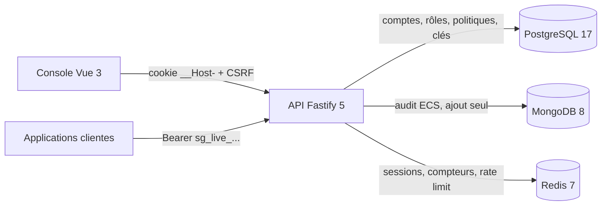

# ShieldGate

[](https://github.com/KarnasZiad/ShieldGate/actions/workflows/ci.yml)
[](https://github.com/KarnasZiad/ShieldGate/actions/workflows/security.yml)
[](LICENSE)

**Plateforme d'identité auto-hébergée et point de décision d'autorisation** : authentification
centralisée, sessions révocables en temps réel, MFA, clés API, permissions fines RBAC + ABAC et
journal d'audit, pour toutes les applications d'une entreprise.

> Projet de portfolio qui illustre la mission « sécurité » : modèle de menaces STRIDE, checklist
> OWASP ASVS niveau 2 vérifiée par des tests, cryptographie testée contre les vecteurs des RFC.

## Sommaire

- [Ce que fait ShieldGate](#ce-que-fait-shieldgate)
- [Sécurité](#sécurité)
- [Architecture](#architecture)
- [Démarrage rapide](#démarrage-rapide)
- [API](#api)
- [Tests et qualité](#tests-et-qualité)
- [Feuille de route](#feuille-de-route)

## Ce que fait ShieldGate

| Fonction               | Détail                                                                              |
| ---------------------- | ----------------------------------------------------------------------------------- |
| Connexion              | Argon2id, réponses identiques pour tout échec, session opaque dans Redis            |
| Protection des comptes | Verrouillage après 5 échecs, blocage des IP qui pratiquent le credential stuffing   |
| MFA                    | TOTP (RFC 6238), secret chiffré AES-256-GCM, code à usage unique                    |
| Sessions               | Liste et révocation immédiate par l'utilisateur ou un administrateur                |
| Clés API               | `sg_live_…`, HMAC-SHA256 avec pepper, portées, expiration, révocation               |
| Autorisation           | `POST /v1/authorize` : politiques RBAC + ABAC, refus par défaut, `deny` prioritaire |
| Audit                  | Événements au format Elastic Common Schema dans MongoDB, en ajout seul              |

## Sécurité

| Document                                                             | Contenu                                            |
| -------------------------------------------------------------------- | -------------------------------------------------- |
| [Modèle de menaces STRIDE](docs/security/threat-model-stride.md)     | 20 menaces, leurs mesures et les risques résiduels |
| [Checklist ASVS niveau 2](docs/security/asvs-l2.md)                  | Chaque exigence avec son code et son test          |
| [Flux d'authentification](docs/architecture/authentication-flows.md) | Connexion, MFA, sessions, verrouillage             |
| [Modèle d'autorisation](docs/architecture/authorization-model.md)    | Politiques, logique à trois valeurs                |

Quelques choix notables :

- **Aucun attribut manquant ne peut accorder un droit** : les conditions ABAC utilisent une logique à
  trois valeurs, et l'indéterminé déclenche les `deny` sans jamais satisfaire un `allow`.
- **Sessions révocables instantanément** : identifiant opaque de 256 bits ; Redis ne stocke que son
  empreinte SHA-256 ; aucune session n'est mise en cache dans l'API ([ADR 0002](docs/adr/0002-sessions-opaques-redis.md)).
- **Chaque secret a la protection adaptée** : Argon2id pour les mots de passe, HMAC pour les clés
  API, AES-256-GCM avec rotation de clé pour les secrets TOTP ([ADR 0004](docs/adr/0004-hachage-argon2id-et-secrets.md)).
- **Réponses filtrées par schéma** : un champ non déclaré (hash, secret) ne peut pas sortir de l'API.
- **Audit en ajout seul** : le rôle MongoDB de l'API ne peut ni modifier ni supprimer un événement.

## Architecture



Détails : [C4](docs/architecture/c4.md), [modèle de données](docs/database.md),
[ADR](docs/adr/0001-enregistrer-les-decisions-d-architecture.md).

| Couche  | Technologies                                                        |
| ------- | ------------------------------------------------------------------- |
| API     | Node.js 22, Fastify 5, Zod 4 (validation, filtrage, OpenAPI), Pino  |
| Données | PostgreSQL 17 (`citext`, `jsonb`), MongoDB 8, Redis 7 (HyperLogLog) |
| Crypto  | `node:crypto`, `@node-rs/argon2`                                    |
| Tests   | Vitest, `fastify.inject`, Testcontainers                            |
| CI/CD   | GitHub Actions, CodeQL, Trivy, Dependabot, images sur GHCR          |

## Démarrage rapide

Prérequis : Node.js 22, Docker et pnpm via Corepack (`corepack enable`).

```bash
pnpm install
docker compose up -d                        # PostgreSQL, MongoDB, Redis
cp apps/api/.env.example apps/api/.env      # générer les deux secrets (commande dans le fichier)
pnpm --filter @shieldgate/api db:migrate
pnpm --filter @shieldgate/api db:seed       # premier administrateur (SEED_ADMIN_*)
pnpm dev
```

- API : <http://localhost:4000>
- Documentation OpenAPI : <http://localhost:4000/docs>

## API

| Méthode | Route                                  | Accès               | Rôle                                      |
| ------- | -------------------------------------- | ------------------- | ----------------------------------------- |
| POST    | `/v1/auth/login`                       | public              | Mot de passe, puis MFA si activée         |
| POST    | `/v1/auth/mfa`                         | public              | Code TOTP du défi                         |
| POST    | `/v1/auth/logout`                      | session             | Fin de session                            |
| GET     | `/v1/me`, `/v1/me/sessions`            | session             | Profil et sessions actives                |
| DELETE  | `/v1/me/sessions/:id`                  | session             | Fermer une de ses sessions                |
| POST    | `/v1/me/mfa/totp[/activate\|/disable]` | session             | Enrôlement et désactivation de la MFA     |
| GET     | `/v1/users`, `/v1/users/:id`           | `users:read`        | Comptes                                   |
| POST    | `/v1/users`                            | `users:write`       | Création avec politique de mot de passe   |
| PATCH   | `/v1/users/:id`                        | `users:write`       | Nom, statut, rôles (révoque les sessions) |
| POST    | `/v1/users/:id/unlock`                 | `users:write`       | Lever un verrouillage                     |
| DELETE  | `/v1/users/:id/sessions`               | `sessions:revoke`   | Déconnecter un compte partout             |
| POST    | `/v1/api-keys`                         | `api-keys:write`    | Émettre une clé (affichée une fois)       |
| POST    | `/v1/authorize`                        | clé API `authorize` | Décision d'autorisation                   |
| PUT     | `/v1/policies/:id`                     | `policies:write`    | Créer ou modifier une politique           |
| GET     | `/v1/audit-events`                     | `audit:read`        | Recherche dans le journal d'audit         |
| GET     | `/health/live`, `/health/ready`        | public              | Liveness, readiness par dépendance        |

## Tests et qualité

```bash
pnpm test:coverage       # tests unitaires et HTTP (fastify.inject), seuil 80 %
pnpm test:integration    # PostgreSQL, MongoDB et Redis réels (Docker requis)
```

| Niveau      | Exemples                                                                                             |
| ----------- | ---------------------------------------------------------------------------------------------------- |
| Unitaires   | Vecteurs RFC 4226/6238/4648/4231, AES-GCM falsifié, moteur de politiques, politique de mots de passe |
| HTTP        | Énumération, verrouillage, stuffing, fixation de session, CSRF, expirations, IDOR, rejeu TOTP        |
| Intégration | Verrou de migration, unicité `citext`, TOTP concurrent, HyperLogLog, index TTL, bout en bout         |

Chaque pull request passe par la CI (format, lint, typecheck, tests et couverture, build, tests
d'intégration, image Docker scannée, CodeQL, Trivy, revue des dépendances) et par la checklist
sécurité du [template de PR](.github/pull_request_template.md).

## Feuille de route

- [x] Conception : cahier des charges, user stories, C4, STRIDE, ADR
- [x] Comptes, sessions Redis, verrouillage, détection de credential stuffing, CSRF
- [x] MFA TOTP, clés API, moteur de politiques RBAC + ABAC, point de décision
- [x] Journal d'audit ECS dans MongoDB, checklist ASVS niveau 2
- [ ] Console d'administration Vue 3 (comptes, sessions, clés, politiques, audit)
- [ ] MFA obligatoire pour les administrateurs, audit des refus 403
- [ ] OAuth 2.1 / OpenID Connect (`oidc-provider`), rotation des clés JWKS
- [ ] Passkeys WebAuthn, connexion Google et GitHub
- [ ] Détection d'anomalies (nouveau pays, voyage impossible), export SIEM
- [ ] Kubernetes (Helm, k3s), Sealed Secrets, tests de charge k6, scan OWASP ZAP
- [ ] SDK npm `@shieldgate/client`

## Licence

[MIT](LICENSE) © 2026 Ziad Karnas
