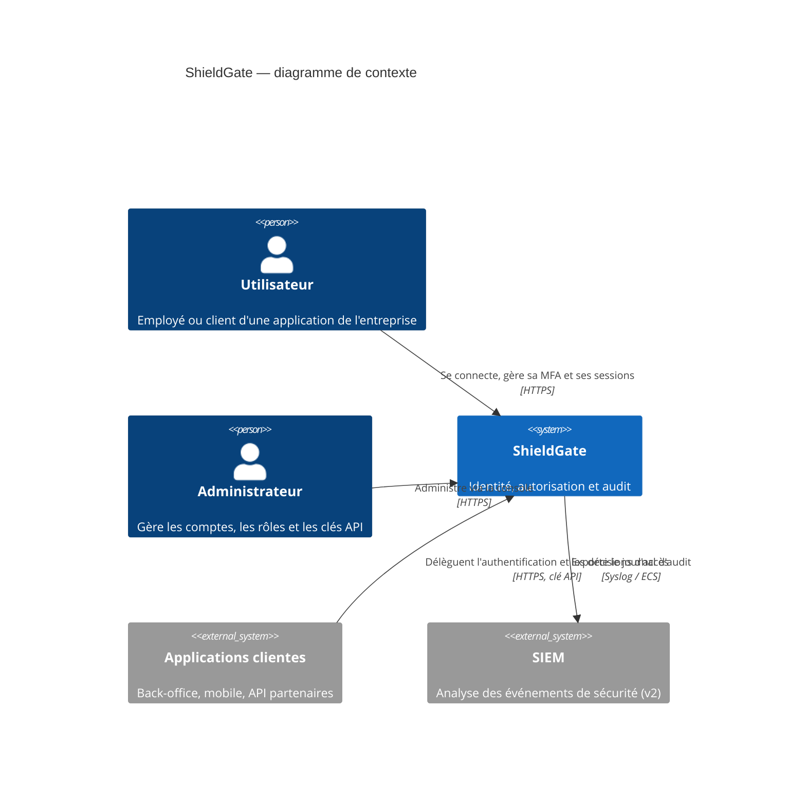
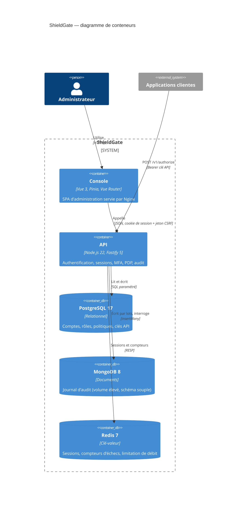
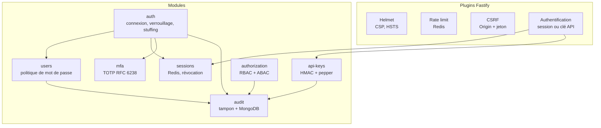

# Architecture — modèle C4

## Niveau 1 — Contexte

## Niveau 2 — Conteneurs

## Niveau 3 — Composants de l'API

Chaque module expose des interfaces (`UserRepository`, `SessionStore`, `AuditSink`...) avec une
implémentation réelle (PostgreSQL, Redis, MongoDB) et une implémentation en mémoire pour les tests
rapides. Les tests d'intégration valident les implémentations réelles avec Testcontainers.
