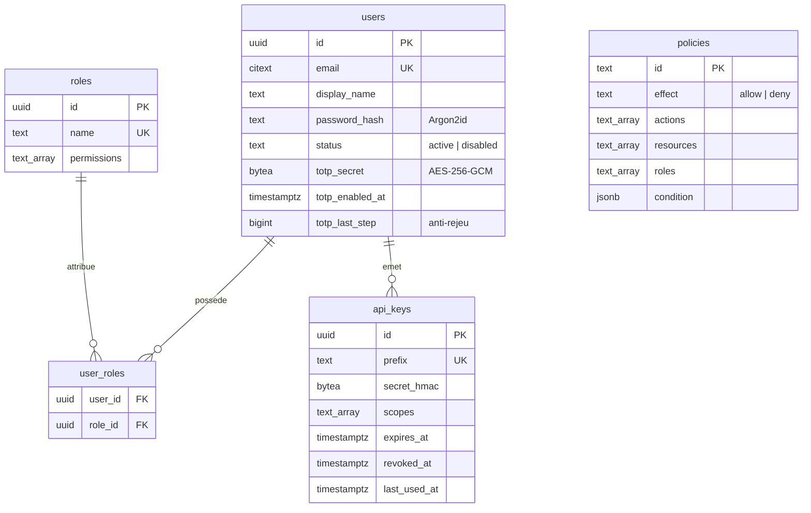

# Modèle de données

## PostgreSQL : identités et autorisations

Migrations SQL versionnées dans `apps/api/migrations`, appliquées par un migrateur qui prend un
verrou consultatif (`pg_advisory_lock`) : deux instances qui démarrent ensemble ne migrent pas en
même temps.



## MongoDB : journal d'audit

Collection `audit_events`, un document par événement, champs inspirés d'Elastic Common Schema pour
un export SIEM sans transformation :

```json
{
  "@timestamp": "2026-10-20T09:30:12.421Z",
  "event": {
    "action": "user.login",
    "category": ["authentication"],
    "outcome": "failure",
    "reason": "invalid_credentials"
  },
  "user": { "id": "4f6c...", "email": "amina@exemple.ma" },
  "source": { "ip": "196.12.4.8" },
  "user_agent": { "original": "Mozilla/5.0 ..." },
  "trace": { "id": "req-8f2a" }
}
```

| Index                                | Usage                                       |
| ------------------------------------ | ------------------------------------------- |
| `_id` (par défaut)                   | Derniers événements, pagination par curseur |
| `{ "user.id": 1, "_id": -1 }`        | Historique d'un acteur                      |
| `{ "user.target.id": 1, "_id": -1 }` | Historique d'un compte visé par une action  |
| `{ "event.action": 1, "_id": -1 }`   | Filtre par type d'événement                 |
| TTL sur `@timestamp` (400 jours)     | Rétention automatique                       |

L'`ObjectId` est croissant dans le temps : trier sur `_id` donne l'ordre chronologique et un
curseur stable, sans index supplémentaire sur `@timestamp`.

Pourquoi MongoDB : volume élevé en écriture, attributs variables selon l'événement, et besoin
d'interroger par champs imbriqués. Le choix est détaillé dans l'[ADR 0003](adr/0003-postgresql-pour-l-identite-mongodb-pour-l-audit.md).

## Redis : état éphémère

| Clé                                | Contenu                                | TTL             |
| ---------------------------------- | -------------------------------------- | --------------- |
| `sg:session:<sha256>`              | Session (utilisateur, IP, CSRF, dates) | 30 min glissant |
| `sg:user-sessions:<userId>`        | Ensemble des sessions d'un utilisateur | 12 h            |
| `sg:mfa:challenge:<id>`            | Défi MFA en attente                    | 5 min           |
| `sg:login:fail:<empreinte e-mail>` | Compteur d'échecs                      | 15 min          |
| `sg:login:accounts:<ip>`           | HyperLogLog des comptes tentés         | 10 min          |
| `sg:ip-block:<ip>`                 | Blocage pour bourrage d'identifiants   | 1 h             |
