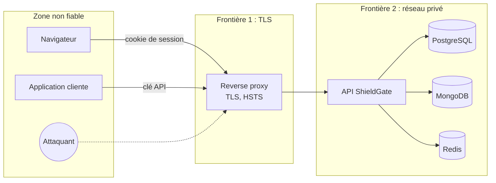

# Modèle de menaces (STRIDE)

Version 1, revue à chaque fonctionnalité qui touche une frontière de confiance. Méthode : diagramme
de flux de données, puis menaces STRIDE par élément, puis mesures et risque résiduel.

## Actifs

| Actif                         | Pourquoi il compte                                               |
| ----------------------------- | ---------------------------------------------------------------- |
| Mots de passe et secrets TOTP | Permettent d'usurper n'importe quel utilisateur                  |
| Identifiants de session       | Équivalent d'un mot de passe pendant leur durée de vie           |
| Clés API                      | Donnent accès au point de décision au nom d'une application      |
| Politiques d'autorisation     | Les modifier revient à s'octroyer tous les droits                |
| Journal d'audit               | Preuve en cas d'incident ; doit rester complet et non modifiable |

## Diagramme de flux et frontières de confiance

## Menaces et mesures

| ID  | STRIDE                 | Menace                                                     | Mesures                                                                                                       | Statut |
| --- | ---------------------- | ---------------------------------------------------------- | ------------------------------------------------------------------------------------------------------------- | ------ |
| S1  | Spoofing               | Bourrage d'identifiants avec des fuites d'autres sites     | Rate limit par IP, HyperLogLog des comptes tentés par IP, blocage 1 h, audit                                  | v1     |
| S2  | Spoofing               | Force brute sur un compte ciblé                            | Verrouillage après 5 échecs / 15 min, Argon2id coûteux, MFA                                                   | v1     |
| S3  | Spoofing               | Énumération des comptes                                    | Réponses et temps identiques (hash factice), verrouillage indiscernable d'un échec                            | v1     |
| S4  | Spoofing               | Vol ou fixation de session                                 | Cookie `__Host-` HttpOnly Secure SameSite=Strict, nouvel identifiant à chaque connexion                       | v1     |
| S5  | Spoofing               | Rejeu d'un code TOTP intercepté                            | Dernier pas utilisé mémorisé : un code ne sert qu'une fois                                                    | v1     |
| S6  | Spoofing               | Clé API divulguée                                          | Portées minimales, expiration, révocation immédiate, `last_used_at` visible                                   | v1     |
| T1  | Tampering              | CSRF sur la console                                        | SameSite=Strict, contrôle de `Origin`, jeton de synchronisation dans `X-CSRF-Token`                           | v1     |
| T2  | Tampering              | Injection SQL ou NoSQL                                     | Requêtes paramétrées (`pg`), filtres Mongo construits côté serveur, validation Zod stricte                    | v1     |
| T3  | Tampering              | Modification des politiques par un compte compromis        | Permission dédiée `policies:write`, audit de chaque changement, MFA exigée (v2)                               | v1     |
| T4  | Tampering              | XSS dans la console : actions au nom de l'administrateur   | Échappement Vue, aucun `v-html`, CSP Nginx sans `unsafe-inline`, cookie HttpOnly, jeton CSRF gardé en mémoire | v1     |
| R1  | Repudiation            | Un administrateur nie une action                           | Audit ECS horodaté avec acteur, IP, user-agent, identifiant de requête                                        | v1     |
| R2  | Repudiation            | Effacement du journal d'audit                              | Rôle MongoDB applicatif limité à `insert` et `find` (ni `update` ni `delete`), rétention par TTL              | v1     |
| I1  | Information disclosure | Fuite de la base des comptes                               | Argon2id, secrets TOTP chiffrés AES-256-GCM, clés API en HMAC avec pepper hors base                           | v1     |
| I2  | Information disclosure | Secrets dans les logs                                      | Redaction Pino (`authorization`, `cookie`, `password`), audit sans secret                                     | v1     |
| I3  | Information disclosure | Messages d'erreur trop bavards                             | Réponses `application/problem+json` génériques, détails uniquement dans les logs                              | v1     |
| D1  | Denial of service      | Saturation du hachage Argon2 par des requêtes de connexion | Rate limit avant tout calcul, longueur de mot de passe bornée (128)                                           | v1     |
| D2  | Denial of service      | Verrouillage volontaire des comptes d'autrui               | Verrouillage temporaire (15 min) et non permanent ; déverrouillage par un administrateur                      | v1     |
| D3  | Denial of service      | MongoDB indisponible bloquant les connexions               | Audit asynchrone par lots, tampon borné, la connexion n'attend jamais l'audit                                 | v1     |
| E1  | Elevation of privilege | Accès horizontal (IDOR) aux sessions d'un autre            | Chaque route vérifie la propriété ou la permission via le moteur de politiques                                | v1     |
| E2  | Elevation of privilege | Erreur de politique accordant trop                         | Refus par défaut, `deny` prioritaire, tests de non-régression des politiques                                  | v1     |
| E3  | Elevation of privilege | Dépendance compromise                                      | Lockfile, actions épinglées par SHA, Dependabot, Trivy, revue des dépendances en PR                           | v1     |

## Risques résiduels acceptés

| Risque                                                                | Raison                               | Plan                         |
| --------------------------------------------------------------------- | ------------------------------------ | ---------------------------- |
| Hameçonnage en temps réel contournant le TOTP                         | Limite inhérente au TOTP             | Passkeys WebAuthn (v2)       |
| Redis compromis : sessions lisibles                                   | Réseau privé, authentification Redis | TLS Redis en production      |
| Blocage d'une IP partagée (NAT d'entreprise) par le seuil de stuffing | Compromis sécurité / disponibilité   | Liste d'IP de confiance (v2) |
